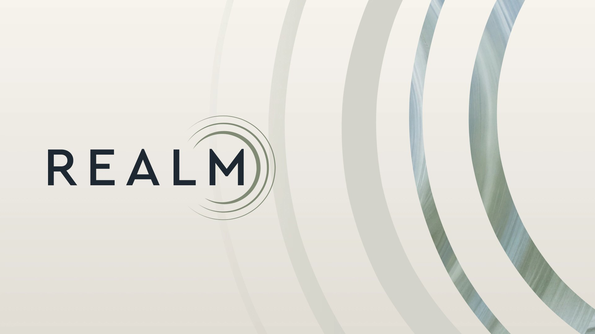
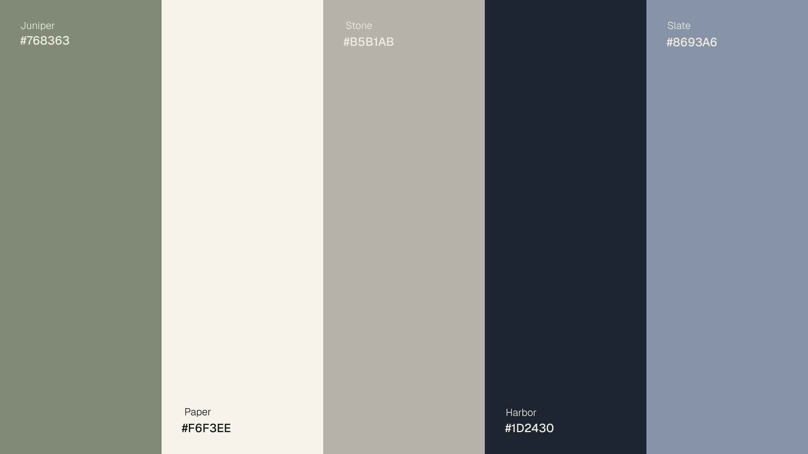
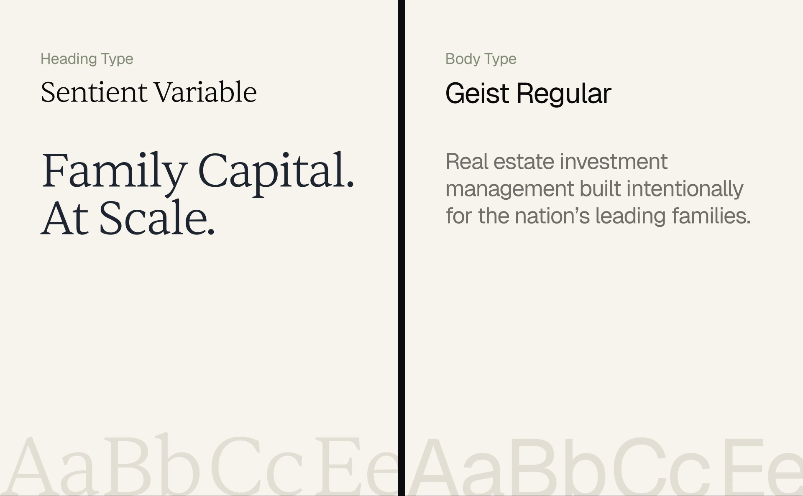
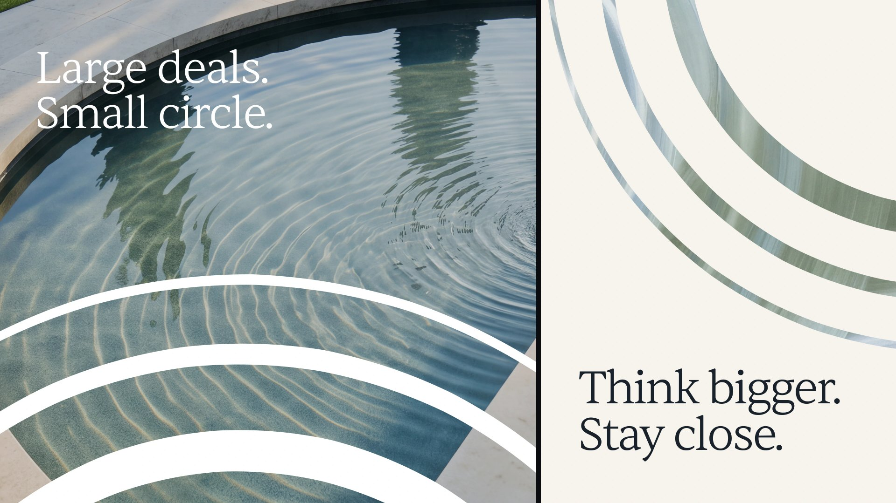
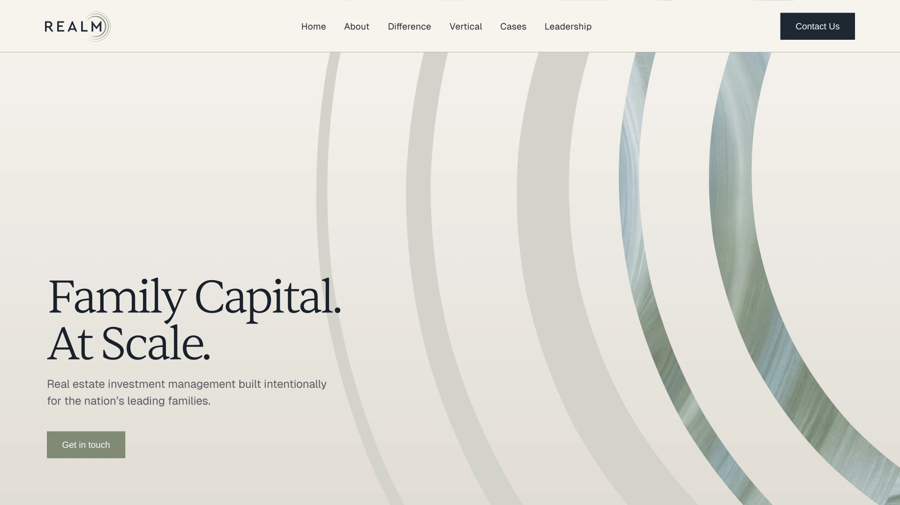
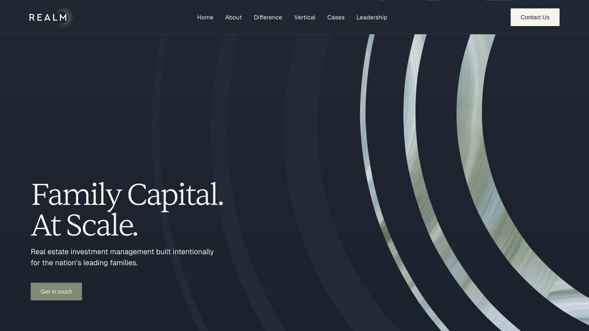
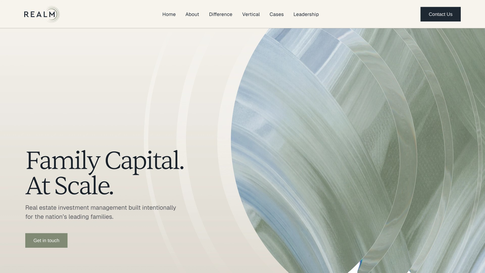
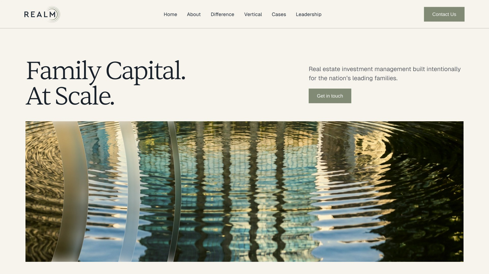

# REALM · Bold · Brand Kit

The **Bold** ("At Scale") direction for the REALM brand, taken from the current moodboard on the brand platform:
https://realm-brand-platform.vercel.app/moodboard/bold-plus

Status: **proposal at moodboard stage, not yet approved by the client.** Updated November 17, 2026.

---

## 1. Logo

The REALM logo **does not change**. The brand is built around it: the REALM wordmark with concentric rings wrapping the M.

**Primary logo: always flat, in a single color** (wordmark and rings in the same color).

| File | Use |
|---|---|
| `logo/realm-logo-harbor.svg` | Primary. All Harbor `#1D2430`. For light backgrounds (Paper). |
| `logo/realm-logo-white.svg` | Primary. All white. For dark backgrounds (Harbor). |

**Secondary logo: rings in Juniper** `#818A75`, for when the logo can carry a touch of color.

| File | Use |
|---|---|
| `logo/realm-logo-harbor-juniper.svg` | Secondary. Harbor wordmark, Juniper rings. For light backgrounds. |
| `logo/realm-logo-white-juniper.svg` | Secondary. White wordmark, Juniper rings. For dark backgrounds. |

- **Still needed from the client:** the original logo masters and the wordmark font. The SVGs above are built from the logo on the current website.



---

## 2. Color

Five colors: a warm light base (Paper), a near-black (Harbor), one accent (Juniper) and two supporting neutrals.

| Name | HEX | RGB | Role |
|---|---|---|---|
| **Paper** | `#F6F3EE` | 246 243 238 | Main background. A warm off-white. |
| **Harbor** | `#1D2430` | 29 36 48 | Text, logo and dark backgrounds. A near-black navy. |
| **Juniper** | `#818A75` | 129 138 117 | Accent. Buttons, calls to action, rings. |
| **Stone** | `#B5B1AB` | 181 177 171 | Warm neutral. Background arcs, rules. |
| **Slate** | `#8693A6` | 134 147 166 | Cool neutral. Supporting tone, textures. |

> **Juniper:** the label on the Figma color slide reads `#768363`, but every piece uses `#818A75` as the fill. Use `#818A75`.



---

## 3. Typography

| Role | Typeface | Use |
|---|---|---|
| **Headings** | **Sentient Light** (serif) | Always in **Light**. Large size, tight leading, sentence case with a full stop. E.g. "Family Capital. At Scale." |
| **Body** | **Geist Regular** (sans serif) | Running text, navigation, buttons, labels. |

- **Sentient:** Indian Type Foundry, Fontshare Free License (FFL). The full family is in `fonts/Sentient_Complete.zip` (OTF, TTF and web fonts, plus the license).
  - Design apps: install the OTF files from `Fonts/OTF` and use **Sentient Light** for headings.
  - Web: use the `.woff2` files in `Fonts/WEB`.
- **Geist:** Vercel, SIL Open Font License, free on Google Fonts (fonts.google.com/specimen/Geist).
- Headings in Harbor; body in Harbor or a muted gray. Calls to action in Geist Regular on a Juniper button with square corners.



---

## 4. Visual direction

**Idea:** "At Scale". The logo's concentric rings, scaled up to the size of architecture. Oversized arcs run off the edge of the page.

1. **Oversized arcs, cut by the edge.** Thick concentric bands in soft Stone on Paper, or one step lighter than Harbor on Harbor.
2. **Arcs as windows.** Some bands open onto a texture or a photo instead of a flat color.
3. **Painted texture.** Broad oil-paint strokes in Juniper, Slate and Paper. Material and warmth, without a photo.
4. **Generous space.** Clean Paper, one large headline, one short paragraph, one Juniper button.



---

## 5. Imagery

Cinematic and quiet. Water, landscape and material, with the arcs echoing what is already in the frame.

**Do**
- Depth, blur and selective focus
- Real shadow and asymmetric framing
- Water, open sky, cypresses, stone
- Concentric ripples that meet the arcs

**Avoid**
- Flat, evenly lit, symmetrical shots
- Buildings as the main subject
- Translucent color overlays on photos
- Generic stock-office scenes

**Headline voice:** short, two beats, full stops.
- Family Capital. At Scale.
- Large deals. Small circle.
- Think bigger. Stay close.

---

## 6. Applications · website hero






---

## 7. Tokens

```css
/* REALM · Bold */
:root {
  --realm-paper:   #F6F3EE;
  --realm-harbor:  #1D2430;
  --realm-juniper: #818A75;
  --realm-stone:   #B5B1AB;
  --realm-slate:   #8693A6;

  --font-heading: "Sentient", Georgia, serif;
  --font-heading-weight: 300; /* Light */
  --font-body: "Geist", "Helvetica Neue", Arial, sans-serif;
}
```

---

## Files in this kit

```
realm-bold-brand-kit/
  REALM-Bold-Brand-Kit.pdf     the designed version of this document
  REALM-Bold-Brand-Kit.md      this document
  logo/                        SVG logo, primary (flat) and secondary (Juniper rings)
  fonts/Sentient_Complete.zip  Sentient (OTF, TTF, web) with license
  images/                      Bold moodboard slides, 1920 px
```

Source of truth: the Bold moodboard in Figma (frame 2121:1890). Full slides with motion are on the brand platform.
